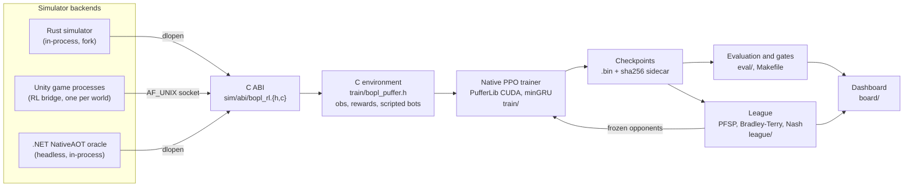

# bopl-rl

Self-play reinforcement learning for
[Bopl Battle](https://store.steampowered.com/app/1686940/Bopl_Battle/), a 2D
platform fighter with deterministic fixed-point physics. The project covers the
whole loop: a seeded multi-agent environment behind one C ABI, recurrent PPO in
a native CUDA trainer built on PufferLib, a permanent league rated with
Bradley-Terry and Nash averaging, and determinism and parity gates that every
simulator change has to pass before it reaches training.

Training runs on a deterministic reimplementation of the game's simulation in
Rust, so thousands of worlds step in-process instead of one game process per
world.

This is an independent, unofficial project and is not affiliated with or
endorsed by the developers of Bopl Battle. **The game is not in this
repository.** Everything derived from it, the Unity project, the decompiled
scripts and the data the simulator embeds, lives in a private submodule at
`game/` that is not published. Running anything that plays a game needs that
submodule, which in turn needs a legal copy of Bopl Battle. See
[The game/ submodule](#the-game-submodule).

## Architecture



## Environment

The environment is written in C (`train/bopl_puffer.h`) and reads simulator
state through the ABI, so the observation, reward and bot code is the same for
every backend. The full contract is in [docs/README.md](docs/README.md).

- **Control.** One decision every four 60 Hz ticks (15 per second): one of 256
  stick encodings and one of 16 combinations of jump, dash, arrow and platform
  buttons. Buttons stay held between decisions.
- **Observation delay.** World observations are nine ticks (150 ms) old; the
  previous action is visible immediately. The single-roundtrip sampled step
  captures the delayed sample without a second call.
- **Partial observability.** An invisible opponent's position and body are
  masked while its sprite alpha is below 0.2; loadouts and cooldowns are public.
- **Observation layout.** Players (self first), up to 64 nearby entities, 32
  slimes and 24 ability slots. Rows beyond capacity are truncated
  deterministically and the overflow is counted in training and evaluation
  metrics. Ability ids index a learned embedding table instead of entering the
  network as ordinal scalars. The v4 layout adds relational and terrain-ray
  features.
- **Rewards.** +1 win, -1 loss, -0.5 per player at timeout, no per-tick reward.
  A round the game leaves undecided (mutual elimination on one tick) is a loss
  for everyone in it. Optional kill/death shaping excludes self-kills, and
  `styles/` holds optional play-style shaping terms. `make check-reward`
  checks the terminal outcomes and their incentive ordering on hand-built
  states.
- **Scripted opponents.** Hand-written C bots (`train/bopl_bots.h`,
  `train/bopl_bots_v2.h`) and search bots serve as fixed evaluation anchors and
  as training opponents.

## C ABI

Every backend implements one versioned C ABI (`sim/abi/bopl_rl.h`): reset
(also split into begin/finish, so a game process can load a scene while the
caller does other work), step with action repeat, the sampled step, lossless
replay export, source and catalogue hashes, and fork of a live world.
`bopl_rl_open` either spawns a persistent headless game process and talks to it
over a Unix socket, or `dlopen`s an in-process library (the Rust simulator or
the .NET oracle), one private copy per handle. All state crossing the ABI is
signed Q32.32 fixed point, so two backends can be compared bit for bit. The
Rust library also has its own smaller C API (`native/include/bopl.h`) and
Python bindings (`native/python/`).

## Training

`train/train.py` configures a pinned PufferLib native trainer (hash-checked
download by `train/setup.py`, local changes in `train/pufferlib-bopl.patch`).
Rollout collection, the minGRU policy, the PPO loss, the backward pass and the
optimizer all run in CUDA; Python only configures the run, publishes
checkpoints and metrics, and schedules evaluation.

- **Encoders.** A linear encoder, and a set encoder that max-pools player,
  ability-slot, entity and slime rows and fuses the pools with the flat
  self/action path. The v4 encoder (`--encoder v4`) reads the richer layout,
  with optional Fourier (`--aim-fourier`) and autoregressive (`--aim-ar`) aim
  parameterizations.
- **Self-play.** Half the games are current-policy self-play. The other half
  play frozen opponents in opponent slots, drawn by prioritized fictitious
  self-play (`league/pfsp.py`) from the run's own snapshots and from league
  members. Opponents are weighted by `(1 - x)^p` on the learner's draw-aware
  score `x`, falling back to `x(1 - x)` when the learner can beat nothing.
  A slot retires an opponent once a Wilson interval says the matchup is settled.
- **Exploiters** are not a separate mechanism: a run from random init whose
  opponent set names one league member.
- **Checkpoints** are immutable float32 blobs with a SHA256 sidecar recording
  the architecture; loading a member into a run of a different shape is refused,
  because mismatched weights would otherwise load silently and play at chance.
- **Sweeps and research.** `train/sweep/` runs hyperparameter and reward sweeps
  from TOML configs; `train/research/` holds pre-registered experiment arms and
  their analysis. Write-ups live in `native/rl/research/`.

## League

`league/` is a permanent registry of members (trained mains, exploiters and
specialists, scripted bots, random) and aggregated payoff counts keyed by a
*condition*: simulator hash, loadout distribution, map set, episode length and
observation delay. Ratings are fitted post hoc under one fixed condition, never
online inside the training loop.

- **Bradley-Terry Elo**, anchored at random = 0, with bootstrap intervals over
  side-swapped seed pairs.
- **Nash averaging**, because a league exists to produce non-transitive
  matchups and Elo is not invariant to adding redundant copies of a member.
  `python league check` demonstrates both on matrices with known answers.
- **Candidates** are rated against frozen member ratings without refitting the
  league.

Details and commands are in [docs/LEAGUE.md](docs/LEAGUE.md).

## Evaluation gates

A policy only learns what the simulator teaches it, so simulator changes are
gated before they reach training. The gates are Make targets and small C
drivers against the C ABI.

**Determinism.** Games are deterministic in their seed, and any deviation is a
failure.
- `eval/reset_check.c`: a reset after dirty gameplay reproduces a fresh seeded
  trajectory exactly.
- `eval/sampled_check.c`: the sampled step equals two separate step commands,
  including episodes that end mid-step.
- `make ability-sweep`: all abilities over all maps, with the simulator run
  against two more copies of itself; crashes and self-disagreement must both be
  zero. This caught entity rows leaking across resets.
- `make replay-selfcheck` / `replay-roundtrip`: a recorded corpus replayed in
  the backend that produced it reproduces the saved results.

**Parity (reimplementation against the reference).**
- `make map-sweep-3000`: every map, 2- and 6-player layouts, 3,000 ticks per
  case, discrete player and slime state required exact.
- `make map-sweep-endgame`: the same, run through sudden death until the round
  resolves; it found a round-resolution ordering bug.
- `make rust-ab-suite`: scripted A/B probes (`eval/rust_ab/`), with a
  comparator so a probe that only prints cannot pass by exiting 0.
- `make replay-ab` / `replay-sweep` / `replay-visible`: re-step saved
  evaluation games in both backends and report the first divergence, ranked by
  whether a policy could observe it.

Parity is measured with a bit-exact Q32.32 build (`--features q32`); training
uses an f64 build of the same code. A divergence where both Rust builds agree
with each other but not the reference is a logic defect and is fixed; one that
is only arithmetic is recorded. Divergences, root causes and negative results
are logged in [eval/divergence/FIXTURES.md](eval/divergence/FIXTURES.md).

**Evaluation protocol.** Side-swapped pairs on fixed seeds, scored draw-aware
(win 1, draw 0.5, loss 0) from the simulator's own end-of-round flags, on
held-out maps as well as training maps. Series plans record source, runtime,
baseline and opponent identities, so an incomplete or changed run is never
silently resumed. `eval/benchmark.c`, `eval/writer_bench.c` and
`eval/bench_throughput.py` measure simulator and observation-writer throughput.

## The simulator

`native/src/` is a deterministic reimplementation of the game's simulation in
Rust, used for fast training. It covers movement and collision, the physics
bodies, the abilities (coverage in `native/data/ability-coverage.json`),
slimes, sudden death and round resolution. It builds as `libbopl_sim` (rlib,
cdylib and staticlib), exports the C ABI above, and supports fork, which the
game process cannot. `native/pgo/` holds a profile corpus of recorded
self-play games for a profile-guided build.

The simulator embeds data derived from the game at build time: fixed-point
sin/tan lookup tables, a map and prefab export, reset states and three recorded
replays. They come from the `game/` submodule through symlinks under
`native/data/` and `native/fixtures`. `native/build.rs` lists the files;
without them the crate still builds, the unit tests that need them are
skipped, and the first use panics with a message naming the missing file.

## The game/ submodule

`game/` is a private repository (the Unity project of the game as exported by
AssetRipper, the decompiled scripts the .NET oracle compiles, and every table,
export, reset state and reference trace extracted from the game). It is not
published and never will be. This repository reaches it only through
`game/` and the committed symlinks into it:

| symlink | points into game/ |
| --- | --- |
| `native/data/{sinlut.bin,tanlut.bin,rollout.json,level1-movement*.json,rollout-goldens,full-reference.json,assets-reference.json,map-coverage.json}` | tables, map export, reset states, source pins |
| `native/fixtures`, `native/reference-export` | reference traces, the Unity asset export |
| `sim/Gameplay`, `sim/Oracle/fixtures`, `sim/Export/{settings,asset-names,execution-order}.json` | the oracle's game scripts and extracted settings |
| `Builds` | the Unity player builds (gitignored output of `just unity-build`) |

The in-game RL bridge (`bridge/`: headless mode, observation capture,
telemetry, the in-game agent, the reference-capture instrumentation and the
editor build and export scripts) is this repository's code. The Unity project
reaches it through `game/Assets/Bridge`, a symlink back to `bridge/`, so it
compiles into Assembly-CSharp with the game's own scripts; the Unity `.meta`
sidecars of those scripts are kept here next to them.
`native/tools/compile/compile.csproj` compiles the same set with the .NET SDK
against the built player's assemblies and is the headless check that the two
halves still fit.

A guard keeps game data out of this repository: `scripts/check-game-data.sh`
refuses Unity project paths, Unity asset types, recorded traces and anything
at a symlink path that is not a symlink. It runs as the pre-commit hook (enable
it once per clone with `git config core.hooksPath .githooks`) and in CI
(`.github/workflows/guard.yml`), together with gitleaks.

## Building

Developed on Linux x86_64 with Rust 1.96, GCC 16 (g++-15 as the CUDA host
compiler), .NET 8 and an RTX 5070. Commands run from the repository root.

### Without the game

A plain clone (no submodule) builds the parts that do not need the game. These
were checked on a fresh clone:

| command | result |
| --- | --- |
| `cargo build --release --manifest-path native/Cargo.toml` | builds `libbopl_sim` (f64 build used for training), with a warning that game data is missing |
| `cargo build --release --features q32 --manifest-path native/Cargo.toml --target-dir native/target-q32` | builds the bit-exact Q32.32 variant used by the parity gates |
| `cargo test --release --manifest-path native/Cargo.toml` | the tests that do not need game data pass; the rest are ignored |
| `make all writer-bench` | builds `libbopl_rl.so` and the gate drivers into `native/artifacts/rl/` |
| `make check-reward` | passes: reward semantics on hand-built states, no simulator needed |

Rust 1.85 or later is required (edition 2024), and a C11 compiler for the C
code. `native/.cargo/config.toml` builds for `target-cpu=native`, so the
library is not portable to other CPUs. If `cargo` fails inside a configured
`RUSTC_WRAPPER` such as sccache, run it with `RUSTC_WRAPPER=` unset.

### With the game

```sh
git clone --recurse-submodules https://github.com/mteam88/bopl-rl   # game/ needs access to the private repo
cargo build --release --manifest-path native/Cargo.toml              # full simulator
cargo test --release --manifest-path native/Cargo.toml               # all tests
dotnet build sim/BoplSim.sln -c Release                              # the .NET oracle (sim/Gameplay comes from game/)
make all research writer-bench                                       # research needs train/setup.py first (PufferLib)
```

The parity gates need the oracle published as NativeAOT
(`dotnet publish sim/Native -c Release -r linux-x64`, see the `REFERENCE`
variable in the Makefile) and the Q32.32 Rust build; `make map-sweep-3000`,
`make rust-ab-suite` and the rest are listed in the Makefile. Unity builds and
asset exports run through `native/justfile` (`just unity-build`,
`just export-assets`), which pass `game/` as the project path.

### Trainer

Needs an NVIDIA GPU with compute capability 12.0, `uv`, and a CUDA-compatible
host C++ compiler; CUDA itself comes from pinned pip wheels. `train/setup.py`
creates the venv and installs PufferLib at a pinned, hash-checked revision;
`train/build.py` applies the patches to an overlay and builds the trainer.

```sh
python3 train/setup.py                                            # venv, pinned PufferLib
native/artifacts/rl/venv/bin/python train/build.py --device cuda  # --cuda-host-compiler g++-15 by default
```

`train/build.py --device cpu` builds the CPU variant. The build hard-codes
`-arch=sm_120`; change it in `train/build.py` for other GPUs.

## Running

Training, evaluation, the league and the dashboard need a simulator backend
that can play games, which means the `game/` submodule (for the Rust simulator
and the oracle) or a Unity build of it (for the game-process backend). With a
backend in place, see [docs/README.md](docs/README.md) for training, series
evaluation, the dashboard and sweeps, and [docs/LEAGUE.md](docs/LEAGUE.md) for
league commands.

## Layout

| path | contents |
| --- | --- |
| `train/` | trainer, CUDA kernels, C environment, scripted bots, sweeps, research arms |
| `league/` | league registry, payoff counts, rating, PFSP |
| `eval/` | evaluation, the gates, the divergence instrument, A/B probes |
| `board/` | dashboard server and web UI |
| `styles/` | play-style shaping terms |
| `sim/abi/` | the C ABI shared by all backends |
| `native/` | the Rust simulator: `src/`, `include/` (C header), `python/` (bindings), `tools/` (verifiers and oracle tools), `rl/research/` (write-ups) |
| `sim/Host`, `sim/Native`, `sim/UnityShim`, `sim/Export` | hosting for the headless .NET reference build: a minimal Unity API shim, scene construction, NativeAOT exports. The gameplay code it hosts is in `game/`. |
| `sim/Oracle/` | reference diff tooling (its fixtures are in `game/`) |
| `bridge/` | the in-game RL bridge, reference-capture instrumentation, and editor build and export scripts |
| `Tools/` | human rating sessions against league members, shader tooling |
| `docs/` | contracts and design notes |
| `game/` | private submodule: the game and everything derived from it |

## License

MIT, see [LICENSE](LICENSE). `train/pufferlib-bopl.patch` and
`train/pufferlib-close.patch` modify PufferLib, which is MIT licensed; see
[NOTICE](NOTICE). The game, its assets and its code are the property of their
developers and are not part of this repository.
