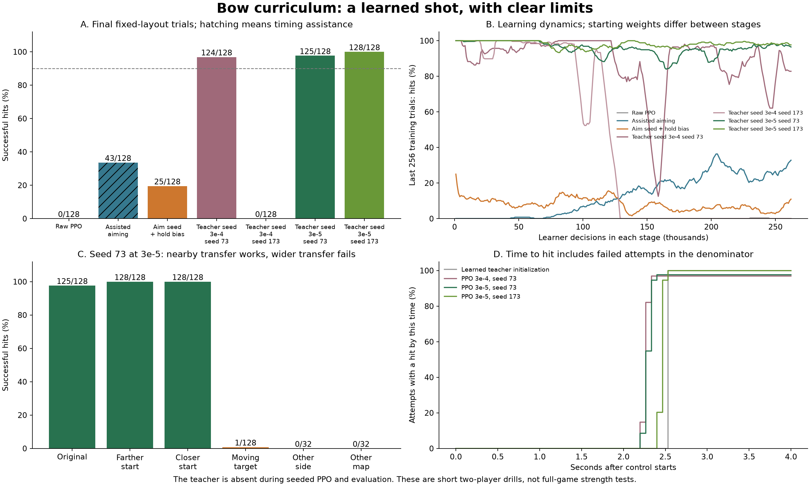

# Bow curriculum — 2026-09-06

A network now controls a complete shot without a script and succeeds reliably
on a small task. Two PPO runs initialized from a verified teaching example and
using a smaller learning rate finish at **125/128 and 128/128 hits**. Both also
hit with argmax actions. Nearby setup changes transfer; moving targets, the
opposite side and another map expose the remaining limitations.

[Learned shot video](../../../artifacts/rl/bow-curriculum/stable-shot.mp4) ·
[Scripted reference video](../../../artifacts/rl/bow-curriculum/baseline-full.mp4) ·
[Results JSON](summary.json) · [Curriculum and long-term goal](../../BOW_CURRICULUM.md)

## Goal and scope

The long-term goal remains superhuman play across all of Bopl Battle, including
finding new combinations and strategies and defending against them. This drill
is a temporary skill-learning and regression test. It does not establish broad
combat strength or implement the future diverse opponent population.

The learner controls aim and Bow held/released in the reconstructed Unity game.
All 256 stick encodings remain available. Jump, dash and platform are
excluded in this stage; the actual loadout stays dash/Bow/platform. The other
player initially sends neutral inputs and still obeys normal game physics.
No script controls the seeded policies during PPO or evaluation.

Each attempt uses map 0, player 1, the ordinary 240-tick warmup, and a further
240-tick limit. It ends on the first accepted learner arrow hit, either player's
death, or timeout. Reward is +1 for a hit, otherwise -0.25 for a learner death,
and zero for other outcomes. A target falling by itself is not success.

The policy receives the same 3,257 features, nine-tick delayed world view and
immediate previous input as the full-game runner. Actions last four ticks. The
128-unit GRU and recurrent PPO update are shared with the full-game trainer.
Full-game rewards, action space and training defaults remain unchanged.

## What the controlled stages established

Every PPO stage below runs 262,144 learner decisions. Initializations and
assistance differ explicitly; the rows are successive diagnostic experiments,
not a claim that only the learning rate differs across the whole table.

| Stage | Script during control? | Final hits | Argmax hit? |
|---|---|---:|---:|
| Raw aim and Bow, seed 73 | No | 0/128 | No |
| Learn aim with charge/release supplied | Timing only | 43/128 | Yes |
| Learned aim, holding-biased Bow initialization | No | 25/128 | No |
| Teacher initialization → PPO, LR 3e-4, seed 73 | No | 124/128 | Yes |
| Same, seed 173 | No | 0/128 | No |
| Teacher initialization → PPO, LR 3e-5, seed 73 | No | 125/128 | Yes |
| Same, seed 173 | No | 128/128 | Yes |

The first raw run finds only one hit in 4,462 training attempts. Prescribing
button timing produces a clear aiming-learning signal. Simply removing that
helper gives zero hits in 128 attempts; a 95% initial holding preference provides
some useful exploration but does not solve reliable release timing. This bias
sets a probability, never a fixed hold duration.

The next stage teaches one known successful shot. The reference points toward
the opponent with a four-code angular offset, waits until Bow is ready, holds
for 64 ticks and releases. It uses the same delayed observations. The network
fits its **38 decisions** with the existing supervised imitation tool: 2,000
updates, loss 0.000504, and exact action agreement. All 38 input vectors match
live evaluator observations bit-for-bit, and there is no action resampling loss.

A second replay with a different seed repeats exactly the same states and
inputs. It is a reconstruction/replication check, **not independent validation**.
No human demonstrations or new human recordings are required for this stage.
The teaching data is intentionally tiny; this is not evidence of general skill.

With the teacher removed, that learned initialization hits in 32/32 sampled
attempts and in argmax play. PPO then changes its controls using game rewards.
At learning rate 3e-4, one seed succeeds but the other loses the shot completely
later in training. The successful seed also fluctuates substantially. Repeating
both seeds at 3e-5 preserves high final success in both. All other training
settings and the starting weights match in this learning-rate comparison.

This supports gentler PPO updates for this initialized drill. It does not prove
that a ten-times lower learning rate is optimal or appropriate for full-game
training. Seven PPO runs total 1,835,008 learner decisions, plus a 2,048-decision
smoke and the short supervised fit. All completed without a game error.

## Behavior and transfer

The final seed-73 policy at LR 3e-5 was tested without any timing assistance:

| Setup | Hits | Argmax hit? |
|---|---:|---:|
| Original training setup, final action RNG seeds | 125/128 | Yes |
| Start about 3.9 units closer | 128/128 | Yes |
| Start about 3.9 units farther away | 128/128 | Yes |
| Opponent walks toward learner | 1/128 | No |
| Opposite player side, same map | 0/32 | No |
| Map 3, original side | 0/32 | No |
| Map 3, opposite side | 0/32 | No |

The nearby starts come from 16 ticks of ordinary movement before handing over
control. They also change cooldown timing and elapsed game time. They are real
physical setup changes, not a pure position-only intervention. The policy keeps
the correct delayed observation history and actual previous action. The moving
opponent chooses a direction toward the learner from its own delayed view.

Different reset seeds on the fixed map produce identical initial positions.
Repeated trials therefore measure sampling reliability on that layout, not
independent spatial generalization. The new setups were excluded from fitting;
the opposite-side and other-map tests are small diagnostics. These reports are
now development evidence and should not become the final strength benchmark.

Both smaller-step policies use learned timing. Their median successful hit times
are 136 and 148 ticks, versus 152 for the learned teacher initialization. The
teacher succeeds in every initial attempt, so faster successful hits alone are
not an unqualified improvement in task performance. The time-to-hit curves keep
failed attempts in their denominator.

An exact tick-level inspection of the successful larger-step seed-73 replay
finds Bow entry at tick 63, firing at 121 and a hit at 136, versus the script's
73 / 137 / 152. Thus the network can change the taught sequence. Button-hold
lengths include time before ability entry; they must not be reported as exact
charging durations. No fixed duration or teacher action is applied at inference.

## Checks and retained artifacts

- The extracted PPO update matches the original implementation's losses and
  resulting weights bit-for-bit on CPU and CUDA.
- Terminal advantages do not bootstrap from the next reset's value.
- Assisted button choices contribute no policy-loss gradient to the button head.
- Running the timing helper internally or supplying its controls externally
  produces identical observations and replay bytes. Previous-input encoding and
  reset observations match exactly.
- The scripted replay matches ordinary game playback through all 392 ticks,
  using the existing audited gameplay projection. A learned replay passes the
  same comparison; the exclusions are listed in the saved parity results.
- The default task after adding setup/opponent options matches the earlier
  seeded run's source, with identical observations and replay bytes.
- Every PPO run retains a copy of its Python sources matching the hashes in its
  configuration, along with checkpoints, logs, trial outcomes and native replays.

Artifacts live under `native/artifacts/rl/bow-curriculum/`. Absolute paths in raw
manifests identify the isolated workspace where the run occurred; the preserved
artifact tree keeps the same relative layout. The shared PPO refactor is the
only change to the existing full-game training path.

## What this changes about the next step

Keep the two smaller-step policies and the teacher initialization as references.
They provide a concrete skill whose retention can be measured. Next, broaden the
Bow curriculum to both directions and moving targets, and require it to preserve
the current successes. Then test repeated shots and recovery, other maps,
movement and additional abilities before returning to full-game competition.

Do not keep making this fixed shot faster as the main objective. The dominant
remaining failure is adaptation to different situations. Skills taught in small
tasks should seed a broader policy; diverse opponents and strategies must decide
whether that policy improves. No current checkpoint earns an all-game or
superhuman claim.
