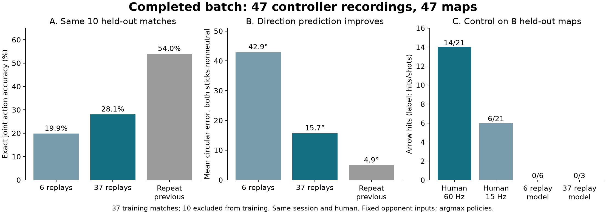

# Completed controller recordings — 2026-09-06

All **47 new recordings (498–544)** were imported and reconstructed. They contain
about **13.4 minutes of play after startup**, on **47 different maps**, with
**12,105 policy decisions**. Matthew confirmed he used the controller: player 2
in these files. Every recording uses Bow, platform, dash in that slot order.

More demonstrations improve action prediction, but the imitation policy still
does not aim usefully on unseen maps when it controls the game.

[Results JSON](completed-summary.json) · [First experiment](REPORT.md) ·
[Held-out policy video: first test map](../../../artifacts/rl/imitation/heldout-imitator.mp4) ·
[Training-replay imitation video](../../../artifacts/rl/imitation/imitator.mp4) ·
[Reproduction workflow](../../IMITATION.md)

## Split and verification

The previously frozen six-replay model was scored on all 39 newly arrived
matches before fitting to them. Its exact joint action accuracy was **16.7%**,
compared with **53.8%** for repeating the previous recorded action.

A fixed plan then selected 37 training matches and kept ten complete matches out
of training: 499, 505, and 537–544. The two older validation matches remain in the
validation set; the final eight recordings supply new game-control tests. All
47 maps are different, so this tests transfer to different matches and maps from
the same person and session. It does not isolate those sources of variation.

The unchanged GRU was trained from the same initialization for 1,000 supervised
updates at learning rate 0.001. There was no checkpoint selection using validation
scores. The training set has 9,489 decisions; validation has 2,616. Dataset
admission checks source/catalog identity, checksum, input mode, and loadout.
The [initial experiment](REPORT.md) supplies exact observation and gameplay
reconstruction checks. Every new file reconstructed without a game error or
observation overflow. These recordings contain 130 arrow shots and 81 arrow
hits in full-rate playback; completed Bow holds have median 52 ticks.

## Prediction on identical held-out matches

| Predictor | Exact joint action | Exact buttons | Mean direction error* |
|---|---:|---:|---:|
| Six-replay model | 19.9% | 63.2% | 42.9° |
| 37-replay model | 28.1% | 77.3% | 15.7° |
| Repeat previous recorded action | 54.0% | 91.1% | 4.9° |

*Circular error where both the predicted and target stick are nonneutral.
Neutral/nonneutral accuracy is reported separately in the JSON. These are
predictions conditioned on the human trajectory and previous human actions.
The persistence baseline is a useful prediction check; it is not a viable policy
from a neutral starting action by itself.

## Actual game control on eight held-out maps

Each variant starts from the same original setup and prefix. After tick 240,
player 2 is controlled by the tested policy or input-playback variant. Player 1
retains recorded input. Runs have the original recording's tick budget, or stop
at an earlier terminal. The policies use argmax and receive their own previous
actions with the existing nine-tick world delay.

| Controller | Arrows fired | Arrow hits | Deaths |
|---|---:|---:|---:|
| Original human inputs, 60 Hz | 21 | 14 | 1 |
| Human inputs resampled to 15 Hz | 21 | 6 | 0 |
| Six-replay model | 6 | 0 | 3 |
| 37-replay model | 3 | 0 | 1 |

The larger model's prediction gain did not produce useful aiming in this test.
It fires less often than the smaller model. The few deaths and small, fixed-input
opponent set are not sufficient for a competitive strength claim.

## What to spend time on next

The data and extractor are ready for the next controlled experiment. Keep the
GRU fixed initially and compare action prediction/control choices: a 30 Hz action
rate while retaining the 150 ms observation delay, and a model that explicitly
predicts changes to the previous input or uses a circular direction loss. The
[first input-only probe](REPORT.md#control-rate-probe) retained six of eight hits
at 30 Hz versus two at 15 Hz; this makes 30 Hz worth testing, not a proven fix.

Require the next version to improve held-out prediction against the persistence
baseline **and** produce appropriate holds, releases and hits while controlling
the game. A large PPO run, more runtime optimization, or merely fitting these
37 replays more tightly would not resolve the demonstrated transfer problem.

The initial training defaults remain unchanged. Frozen model scoring is now
available in `research/score_demonstrations.py`, with explicit rejection of
matches already in a checkpoint's training manifest. All 47 datasets, the split
plan, training logs, checkpoints, evaluations and replays are retained under
`native/artifacts/rl/imitation/` in the main checkout. Absolute paths inside raw
manifests identify the isolated workspace used to run the experiment.
