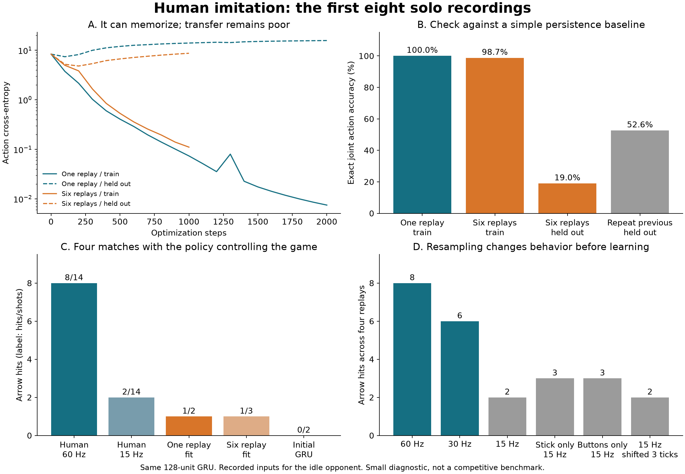

# First human-imitation experiment — 2026-09-06

The existing GRU can memorize a short human demonstration and reproduce a charged
shot in the real game. It has not learned a transferable aiming policy. The next
useful experiment is a small comparison of control rates and action prediction,
rather than a long training run.

[Human replay](../../../artifacts/rl/imitation/human.mp4) ·
[Learned policy controlling the same setup](../../../artifacts/rl/imitation/imitator.mp4) ·
[Human inputs resampled to 15 Hz](../../../artifacts/rl/imitation/human-15hz.mp4) ·
[Machine-readable results](summary.json) · [Reproduction instructions](../../IMITATION.md)

## What was tested

The first eight new Mac recordings, 498–505, contain two players with ability
slots **Bow, platform, dash**. Player 2 is the active controller; player 1 has no
button presses. These are solo drills against an idle player. The new order is
preserved in both inputs and observations, rather than silently treating it as
the existing PPO setup's dash/Bow/platform order.

The dataset contains 2,174 decisions after the four-second startup period.
Training on six complete replays (498, 500, 501, 502, 503, 504) uses 1,562 decisions;
validation on two complete replays (499, 505) uses 612. These are different matches
and maps from the same recording session, not independent human participants.
The single-example sanity check trains on replay 498 and validates on 499.

The 128-unit encoder and 128-unit GRU are unchanged. Supervised training uses
full-episode sequences, angle/button cross-entropy, Adam at 0.001, and no entropy
bonus. The first fit uses 2,000 updates; the six-replay fit uses 1,000. Validation
does not select the final checkpoint. The old PPO policy was not fine-tuned.

## Reconstruction and learning results

- Every one of 3,257 observation features matched the live evaluator bit-for-bit
  at 160 decisions for each of two players: 320 complete player observations.
  This checks the nine-tick delay, previous-action fields, and episode clock.
- Replay 498 matched ordinary game playback for all 983 ticks in the full managed
  gameplay projection, with only the existing audited presentation exclusions.
- The one-replay fit reaches **100% exact joint action accuracy**, loss **0.00748**.
  Its accuracy on replay 499 is **16.2%**.
- The six-replay fit reaches **98.7%** on training matches and **19.0%** on held-out
  matches. Simply repeating the previous recorded action scores **52.6%** on the
  same held-out set. Its button accuracy is 69.8%, versus 91.8% for persistence.

The model can represent the short sequence. This does not establish that the
current PPO objective, entropy setting, or 32-step gradient window would learn
it. The imitation experiment changes the learning objective and unroll length.

## When the model controls the game

Four original setups were used: 498 and 501 from training, 499 and 505 held out.
The original prefix supplies the initial state, the selected policy controls
player 2 after tick 240, and player 1 retains its recorded input. Each run gets
the original match's tick budget, with an earlier stop if the game terminates.
All policies use argmax. This is a small behavior diagnostic, not a tournament.

| Controller | Arrows fired | Arrow hits | Deaths |
|---|---:|---:|---:|
| Original human inputs, 60 Hz | 14 | 8 | 0 |
| Human inputs sampled and held at 15 Hz | 14 | 2 | 0 |
| Initial, untrained GRU | 2 | 0 | 2 |
| One-replay imitation | 2 | 1 | 1 |
| Six-replay imitation | 3 | 1 | 3 |

The one-replay model fires twice and lands one hit on its training setup. Its
completed Bow holds are 52 and 56 ticks, versus the human's 56 and 27 ticks. It
therefore demonstrates learned sustained button control, but drifts from the
human trajectory. Neither fit lands a hit in the two held-out setups.

## Control-rate probe

Input playback alone exposes an additional problem. Human inputs change between
four-tick decision boundaries: sample-and-hold changes 24.6–34.6% of post-startup
input ticks across these eight recordings. Most exact mismatches are not
necessarily large directional errors, but they can change later trajectories.

| Input playback variant | Arrows fired | Arrow hits | Deaths |
|---|---:|---:|---:|
| Original 60 Hz | 14 | 8 | 0 |
| Both controls at 30 Hz | 13 | 6 | 0 |
| Both controls at 15 Hz | 14 | 2 | 0 |
| Stick at 15 Hz, buttons at 60 Hz | 14 | 3 | 0 |
| Buttons at 15 Hz, stick at 60 Hz | 14 | 3 | 1 |
| Both at 15 Hz, decision phase shifted three ticks | 11 | 2 | 2 |

The effect is not just one unlucky decision phase. Both direction sampling and
button timing affect outcomes. However, these counterfactual action streams do
not adjust to their changed trajectories. This does **not** prove that an agent
making fresh decisions at 15 Hz cannot aim well. It shows that these 60 Hz human
demonstrations cannot be treated as behavior-preserving 15 Hz trajectories.

## Next experiment

Keep this verified extractor and the GRU as the baseline. Compare a small 30 Hz
imitation fit with the current 15 Hz fit, keeping the 150 ms world-observation
delay. Thirty hertz preserved six of eight demonstrated hits in the input probe;
it is a candidate, not an established optimum. The trainer's four-tick action
contract remains unchanged by this work.

Evaluate on the additional recordings before scaling. Treat persistence as the
minimum prediction baseline, and score held controls, release timing, shots and
hits when the policy actually controls the game. If transfer remains weak,
compare a prediction of changes to the previous action and a circular direction
loss against the current 256-way direction classifier. Do not infer useful play
from memorization accuracy alone.

All game traces, datasets, checkpoints and videos are retained under
`native/artifacts/rl/imitation/`. The checked-in summary contains source and
checkpoint identities. Original absolute paths in raw manifests identify the
isolated workspace where the experiment ran; the artifact tree is now retained
in the main checkout with the same relative layout. No PPO training run or
production training defaults were changed.
