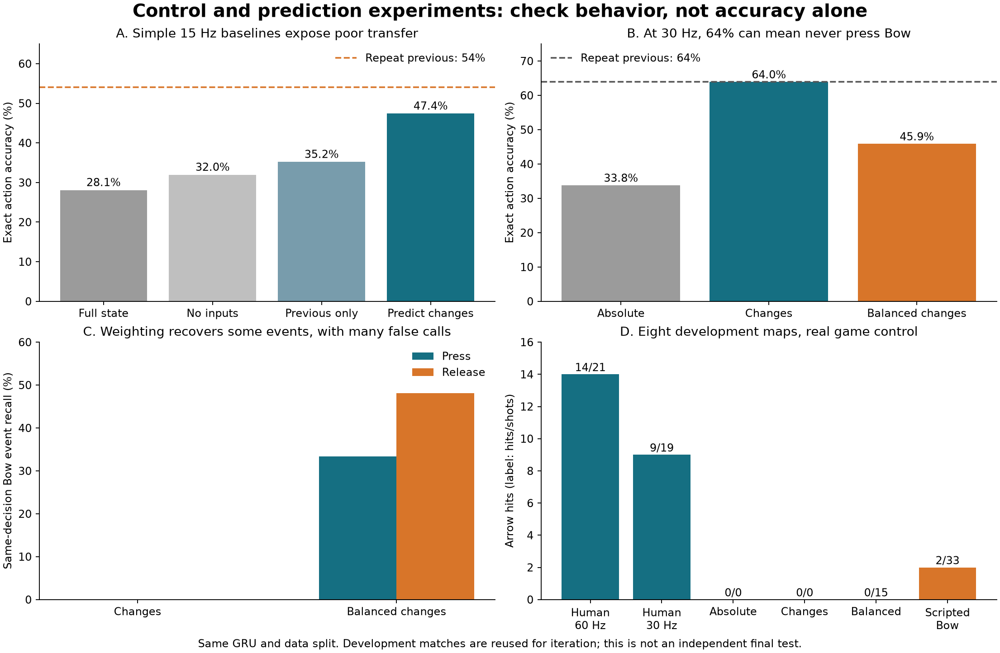
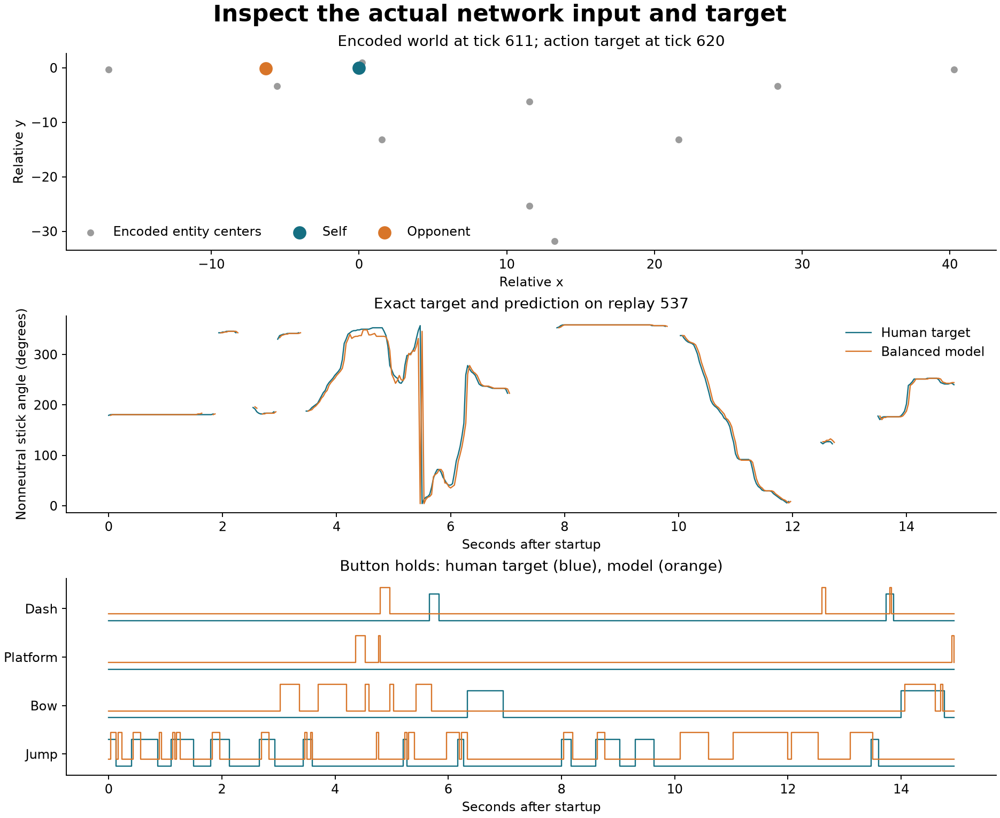

# Control and action-prediction iteration — 2026-09-06

The main finding is a misleading success metric: a model can reach **64% exact
action accuracy while predicting none of the human's Bow presses or releases**.
A higher control rate and a simpler action encoding improve prediction, but do
not by themselves produce a useful aiming policy.

[Actual network inputs and predictions](prediction-inspection.png) ·
[Machine-readable results](summary.json) ·
[Scripted Bow baseline video](../../../artifacts/rl/imitation-controls/scripted-bow.mp4)

This follows the small-step approach in [Karpathy's recipe](https://karpathy.github.io/2019/04/25/recipe/):
check simple baselines, initial loss, causal dependencies, a tiny overfit, and
actual inputs/predictions before adding complexity. The GRU and parameter count
remain fixed. Each change is measured against the earlier version.

## Protocol and checks

The same 37 matches supply training and ten supply development scores. Eight of
those development maps supply game-control tests. They remain excluded from
fitting, but they have now been inspected repeatedly during iteration and are
**development data, not an independent final test set**. Seeds, learning rate
0.001 and 1,000 updates remain fixed; no checkpoint is selected using development
scores. The separate one-replay check uses 4,000 updates.

The checks passed:

- All seven new fits begin within 0.01 of the uniform action loss, log(256×16).
- Gradients do not cross agent/batch boundaries or depend on future observations.
- Sequence evaluation agrees with step-by-step recurrence, including resets.
- All 47 replay pairs agree exactly on world features at shared 15/30 Hz decision
  boundaries. World observations stay nine ticks old; previous input follows
  the selected decision rate. Targets agree at shared boundaries.
- C-encoded previous inputs decode correctly for all 256 stick codes and 16
  button states. The new action mapping is a bijection and a zero change keeps
  both controls, including a neutral stick.
- The tiny change-prediction fit reaches loss 0.000772 and 100% exact action
  accuracy. Its saved predictions equal its targets element-for-element.
- Default policy outputs remain bit-identical to the base revision on the tested
  sequence. Existing PPO defaults and the game build are unchanged.

## Simple input baselines

At 15 Hz, exact joint action accuracy on the same ten development matches is:

| Model | Accuracy |
|---|---:|
| Existing full-state model | 28.1% |
| Same model with all observations zeroed | 32.0% |
| Same model seeing only previous input | 35.2% |
| Full state, predicting action changes | 47.4% |
| Repeat previous recorded action | 54.0% |

The zero-input model predominantly predicts neutral controls. Its higher score
is not useful play; it exposes the weakness of average action accuracy as a
success criterion. The full model fits training matches much better, so the
problem includes poor transfer rather than simply not using its inputs.

The change representation keeps the existing 272 outputs. Stick changes rotate
relative to the previous direction, with an explicit neutral case. Buttons use
XOR with their previous values. Outputs are converted back to absolute action
logits before use. This changes the prediction problem without adding network
parameters.

## Control rate and event weighting

At 30 Hz, the full absolute-action model scores 33.8%. Predicting changes scores
63.95%, essentially equal to the 63.97% persistence baseline. However, on the ten
development matches it predicts **zero of 27 Bow presses and zero of 27 releases**.
The higher number mostly rewards retaining existing controls.

A subsequent fit gives changed and unchanged controls equal total loss weight,
independently for the stick and button heads. Weights are derived from training
frequencies only; reported development losses remain unweighted.

That model recovers 9/27 presses and 13/27 releases at the exact decision where
they occur. It also predicts 264 presses and 194 releases, giving only 3.4% press
precision and 6.7% release precision. Its exact action accuracy falls to 45.9%.
These strict event scores count same-decision matches; they do not allow a timing
tolerance. Actual game execution below checks whether the extra actions help.

The direction plot is conditioned on human previous actions, which explains why
it can track the human smoothly while the autonomous policy fails. The button
plot exposes extra presses and poorly timed releases that average accuracy hides.

## Real game control

The same eight setups, original prefix and recording budgets are used. Other
players retain recorded inputs. All learned policies use argmax.

| Controller | Arrows fired | Hits | Deaths |
|---|---:|---:|---:|
| Human inputs, 60 Hz | 21 | 14 | 1 |
| Human inputs, 15 Hz | 21 | 6 | 0 |
| Human inputs, 30 Hz | 19 | 9 | 3 |
| Previous-input-only model, 15 Hz | 0 | 0 | 1 |
| Change model, 15 Hz | 0 | 0 | 1 |
| Absolute model, 30 Hz | 0 | 0 | 1 |
| Change model, 30 Hz | 0 | 0 | 1 |
| Weighted-change model, 30 Hz | 15 | 0 | 4 |
| Scripted point/hold/release baseline, 30 Hz | 33 | 2 | 1 |

The scripted baseline uses the same delayed observations: point toward the
opponent, hold Bow for 64 ticks when ready, release for at least 16 ticks, and
wait for readiness again. It has no trained weights, ballistic model, movement
planner or access to human target actions. It is a modest gameplay baseline,
not an improved learned policy.

The weighted model starts acting, but its shots do not hit and its deaths rise.
Thirty hertz better preserves the original human shots, but does not solve the
learned model's failure to initiate and sustain useful actions.

## Resulting next target

Use a smaller press–hold–release task as the next learning target, with successful
shots in the actual game as the pass condition. Predicting changes is a useful
representation, but retaining actions must not be mistaken for learning when to
change them. The current per-decision imitation loss leaves a gap between a
human-conditioned predictor and an autonomous controller.

Keep the new diagnostics and scripted baseline. Do not promote these checkpoints
or the 30 Hz contract into the PPO defaults based on the current results. A future
candidate needs both useful event precision/recall and better game outcomes, then
an independent evaluation on fresh setups.

## Reproduction

The [imitation workflow](../../IMITATION.md) remains the entry point. New options:

- `extract_demonstrations.py --repeat 2` creates 30 Hz examples with the same delay.
- `imitate.py --input-mode zero|previous|full` runs input ablations.
- `imitate.py --action-mode delta` predicts changes; `--balance-changes` balances
  changed versus retained controls using training frequencies.
- `evaluate_imitation.py` reads control rate from checkpoints and rejects a
  conflicting override or mixed rates. Older checkpoints retain the 15 Hz default.
- `score_demonstrations.py --examples` saves the actual model inputs, targets and
  predictions. Uniform Bow/platform/dash datasets also receive event scores.
- `check_imitation_contracts.py` checks causality, recurrence and rate alignment.
- `baseline_bow.py` executes the explicit point/hold/release controller.
- `plot_imitation_controls.py` regenerates these figures from the artifact tree.

All data, weights, logs, replays and videos are retained under
`native/artifacts/rl/imitation-controls/`. Checkpoint metadata preserves input
mode, action encoding and control rate; these imitation checkpoints remain
inference artifacts rather than PPO optimizer resumptions.
