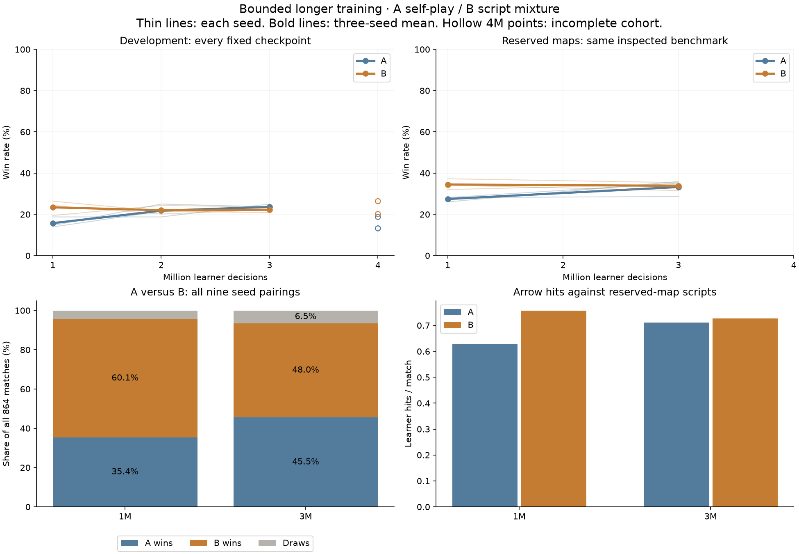
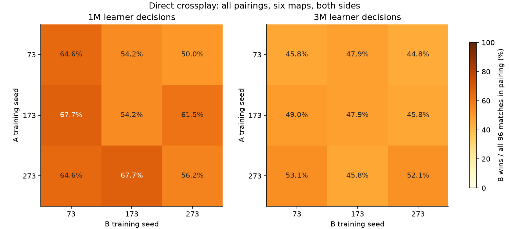
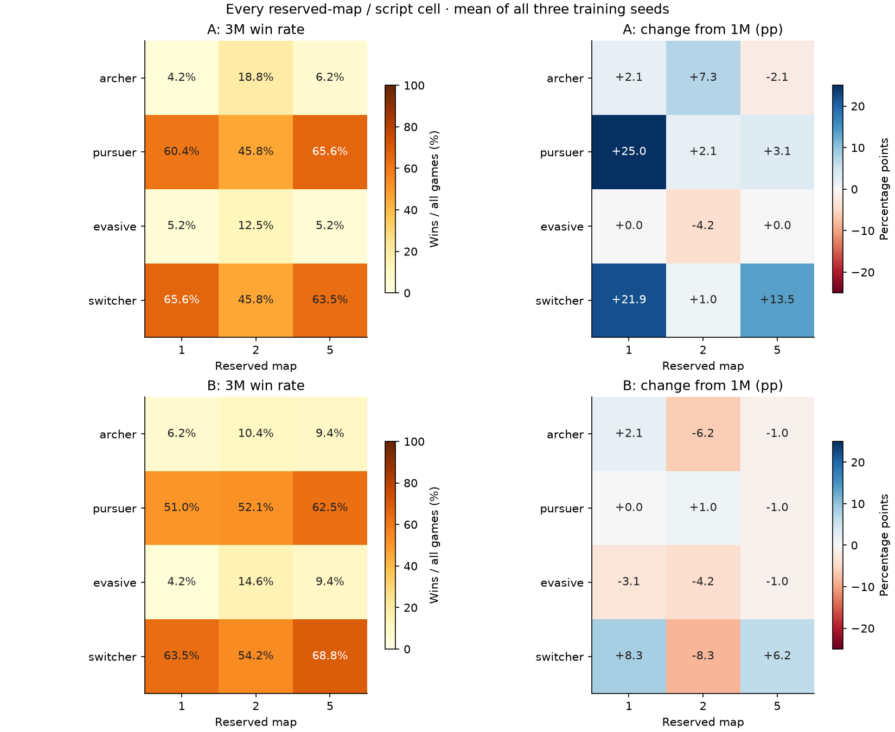
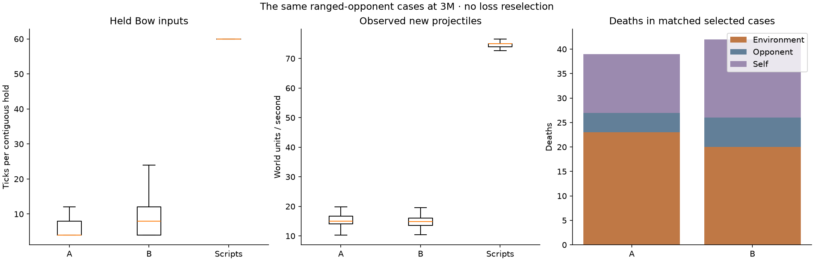

# Longer training: the early B advantage narrows

The script mixture had a large direct advantage at 1M. At the common 3M
checkpoint, direct play is nearly tied: B wins 415/864 games (48.0%), A wins
393/864 (45.5%), and 56 are draws. More training did not preserve B's early
relative advantage on this fixed comparison. This is not evidence of strong
whole-game play or a controlled explanation of why the gap narrowed.

Five runs reached 4M. B seed 73 aborted at 3.84M when 99 visible entities exceeded
the fixed 96-entity observation capacity. **The requested complete six-run 4M
comparison is unavailable.** The declared fallback compares all six policies at
3M (3,001,344 actual learner decisions), selected by checkpoint availability,
while retaining every available 4M
result. The observation limit must be addressed before trusting longer runs.

[Live dashboard and full-match browser](https://powerspec-g728.tailb55536.ts.net:8876/)
· [Methods and reproduction](../../OPPONENT_EXTENSION.md)
· [Frozen primary protocol](protocol.json)
· [Capacity fallback protocol](capacity-fallback-protocol.json)
· [Machine-readable results](summary.json)
· [Audit](audit.json)

## Direct competition

All nine A/B training-seed combinations use six fixed maps, eight paired game
seeds per map, and both player sides. Each checkpoint has 864 games. Draws remain
in the denominator; a higher win share is not conditional on decisive games.

| Checkpoint | A wins | B wins | Draws | B win share |
| --- | --- | --- | --- | --- |
| 1M | 306 | 519 | 39 | 60.1% |
| 3M | 393 | 415 | 56 | 48.0% |

At 3M, B minus A is +2.55 percentage points, with a descriptive 95% bootstrap
interval of -4.51 to +10.30 points. B's own win share falls by 12.04 points from
1M, with an interval of -18.87 to -4.98 points. The intervals resample A and B
training-seed axes separately and paired game-seed blocks within each map.
They describe this small, fixed benchmark; they do not establish equivalence or
predict strength against humans or novel opponents.

## Fixed-script results

Development games are tracking evidence on previously inspected maps and scripts,
not a fresh blind test. Each table entry is wins divided by all 144 games.

| Run | 1M | 2M | 3M | 4M |
| --- | --- | --- | --- | --- |
| A-s73 | 14.6% (21/144) | 25.0% (36/144) | 23.6% (34/144) | 18.8% (27/144) |
| A-s173 | 13.9% (20/144) | 21.5% (31/144) | 22.2% (32/144) | 13.2% (19/144) |
| A-s273 | 18.8% (27/144) | 18.8% (27/144) | 25.0% (36/144) | 13.2% (19/144) |
| B-s73 | 26.4% (38/144) | 21.5% (31/144) | 20.8% (30/144) | Unavailable |
| B-s173 | 24.3% (35/144) | 20.1% (29/144) | 22.2% (32/144) | 20.1% (29/144) |
| B-s273 | 19.4% (28/144) | 24.3% (35/144) | 23.6% (34/144) | 26.4% (38/144) |

The reserved-map suite has 384 games per run/checkpoint and four scripts on three
maps. These maps were excluded from training but their 1M results had already
been inspected. The added 3M evaluation uses the unchanged suite.

| Run | 1M | 3M common | 4M |
| --- | --- | --- | --- |
| A-s73 | 28.1% (108/384) | 35.2% (135/384) | 36.5% (140/384) |
| A-s173 | 28.1% (108/384) | 28.6% (110/384) | 29.4% (113/384) |
| A-s273 | 26.0% (100/384) | 35.9% (138/384) | 35.2% (135/384) |
| B-s73 | 37.2% (143/384) | 35.4% (136/384) | Unavailable |
| B-s173 | 32.0% (123/384) | 34.6% (133/384) | 31.8% (122/384) |
| B-s273 | 34.1% (131/384) | 31.5% (121/384) | 34.1% (131/384) |

At 3M, reserved-map wins are 33.2% for A and 33.9% for B. The overall numbers
hide weak ranged play: A wins 9.7% against archers and 7.6% against evasive
scripts; B wins 8.7% and 9.4%, respectively. Each opponent total includes all
288 games across training seeds, maps, and sides. Most wins come against the
pursuer and switcher scripts.

Changes below pair training seeds and both-side game-seed blocks. Maps and
opponents remain fixed; each condition has only three training seeds. Intervals
are descriptive 95% bootstrap intervals, not guarantees of generalization.

| Comparison | Change and descriptive 95% interval |
| --- | --- |
| A 3M minus 1M / development | +7.87 pp [+3.24, +12.27] |
| B 3M minus 1M / development | -1.16 pp [-7.18, +5.32] |
| A 3M minus 1M / transfer | +5.82 pp [+0.09, +11.11] |
| B 3M minus 1M / transfer | -0.61 pp [-4.43, +3.39] |
| B minus A / 3M development | -1.39 pp [-6.02, +3.47] |
| B minus A / 3M transfer | +0.61 pp [-5.30, +6.42] |

Available 4M direct games are shown below as **A's** win rate in each pairing.
B seed 73 is missing, so no pooled three-seed A/B estimate is reported at 4M.

| A seed / B seed | 73 | 173 | 273 |
| --- | --- | --- | --- |
| 73 | Unavailable | 44.8% (43/96) | 39.6% (38/96) |
| 173 | Unavailable | 57.3% (55/96) | 45.8% (44/96) |
| 273 | Unavailable | 38.5% (37/96) | 50.0% (48/96) |

## What the games show

The failure review repeats 18 cases selected for B losses at 1M, plus their
matched A cases, across three maps, three seeds, archers, and evasive opponents.
The same 36 case IDs are traced at 3M regardless of the new result. This is a
conditional diagnostic sample, not an estimate of average performance.

| Selected B cases | 1M | 3M, same case IDs |
| --- | --- | --- |
| Wins | 0 | 2 |
| Losses | 18 | 9 |
| Draws | 0 | 7 |
| Shots | 162 | 237 |
| Hits | 3 | 11 |
| Environment deaths | 31 | 20 |
| Self-credited deaths | 13 | 16 |
| Opponent-credited deaths | 10 | 6 |
| Median held-Bow ticks | 4.0 | 8.0 |
| Median activation-to-shot ticks | 8.0 | 8.0 |
| Median first-observed arrow speed | 14.6 | 14.9 |

B improves from the 18 losses used to select this sample to two wins, nine
losses, and seven draws. Its median held-input run increases from four to eight
ticks, but median activation-to-shot timing stays at eight ticks. Median
first-observed arrow speed stays near 15 world units/s, compared with 75 for
the scripts. The selected games show some improvement without resolving the
short-shot pattern; their changing lengths also affect raw event counts.

The game code makes short charging a plausible weakness: `BowTransform.Shoot`
scales arrow velocity with `loadingFrame + 1`, where loading ranges from zero
to four. `OldUpdate` latches button release and freezes aim before the eventual
shot animation threshold. This supports testing hold and release timing; it
does not establish that timing alone causes losses. Leading, movement, inherited
velocity, platform geometry, survival, and opponent behavior still matter.

Held input runs include time outside active Bow. Activation and shot timing has
four-tick resolution. First-observed projectile speed is not exact muzzle speed.
Death credits do not reveal every cause: an uncredited shove can become an
environmental death. Full state is used only for analysis and replay display;
controllers receive the same delayed observation as during evaluation.

The dashboard includes full saved matches, not just video excerpts. It lists the
checkpoint, map, players, sides, seed, and outcome, with filters, speed controls,
seeking, and native replay downloads. Recorded inputs run through the native
game; publication of the browser replay requires both a matching replay hash
and an identical final player state and tick count. Only matches with recorded
inputs appear in the browser. Native video excerpts are fixed examples rather
than selected highlights.

## Execution, failure, and verification

| Run | Final learner decisions | New learner decisions | Result |
| --- | --- | --- | --- |
| A-s73 | 4,001,280 | 2,999,808 | complete |
| B-s173 | 4,001,280 | 2,999,808 | complete |
| A-s273 | 4,001,280 | 2,999,808 | complete |
| B-s73 | 3,841,536 | 2,840,064 | interrupted |
| A-s173 | 4,001,280 | 2,999,808 | complete |
| B-s273 | 4,001,280 | 2,999,808 | complete |

The six canonical trial attempts add 17,839,104 completed learner decisions beyond
the original checkpoints. 52 evaluation suites
contain 8,976 new completed
benchmark games. Five unavailable 4M suites account for 816 of the 9,792 planned
games. Existing 1M script results are reused. Failure traces replay existing
benchmark cases and do not add independent evaluation games.

B seed 73's failure is a native observation guard abort during collection, not
an out-of-memory diagnosis. The last completed learner count is 3,841,536 and
the last saved policy is at 3,838,464. Its incomplete rollout was not optimized.
The log and compressed core dump are preserved. The fixed model, observation
capacity, reward, learning rate, opponents, and training code were not changed
to make this trial finish. Zero overflow counts in earlier logged rollouts do
not negate the subsequent abort.

A separate operator error interrupted A seed 173 at 3,150,336 decisions: closing
its failed supervisor session terminated the still-running child process group.
Its original attempt was preserved and repeated from the original 1M checkpoint
with identical settings. Both 2M and 3M policy, Adam, Torch random state, and
counters match exactly. Reports tied to the old checkpoint files are archived;
canonical reports use the replacement checkpoint identities. All 960 repeated
evaluation games match their original outcomes and events; every recorded replay
also matches its original hash. The archived attempt adds 2,148,864 repeated learner decisions and 960 repeated
evaluation games to execution cost, but not to the six-trial benchmark.

Continuation restores weights, Adam, Torch random state, counts, recent historical
opponents, and snapshot cadence. Games, recurrent memories, and private NumPy
random state restart at the declared 1M boundary. This is not an exact restoration
of in-progress game trajectories, and both conditions use the same boundary.

Two training processes achieved 4,008 aggregate learner decisions/s in a
346.8-second operational sample, versus 2,614 for the earlier single-run sample.
Concurrent evaluation differed; this was not a controlled throughput experiment.
Per-run wall times overlap and cannot be summed as total elapsed study time.
All raw durations and the repeated attempt remain available in the artifacts.

The audit checks source snapshots, frozen training hashes, binary identities,
initial restored state, milestone budgets, all available evaluation schedules,
per-game records, saved replay hashes, both sets of 36 failure traces, and the
operator-retry checkpoint comparisons. All originally recorded failure replays
are compared byte-for-byte; cases without an original replay are checked against
the original final state and both players' event totals. Raw artifact preservation
is separately verified after copying out of the isolated workspace.

## Next experiment

First make observation coverage explicit for crowded games and prove that longer
runs cannot silently omit game state. Then test a controlled change aimed at the
measured behavior, including charge/release timing and survival, against the
unchanged A/B baselines. More unmodified training alone has not established a
strong policy here. Bow remains a temporary diagnostic; the target is broad
play across abilities, maps, combinations, and adaptive opponents.
