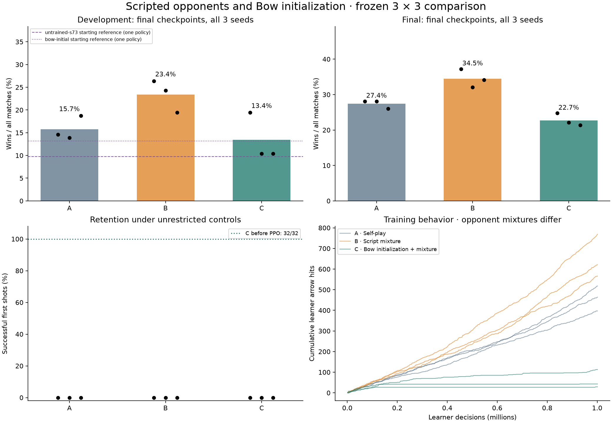
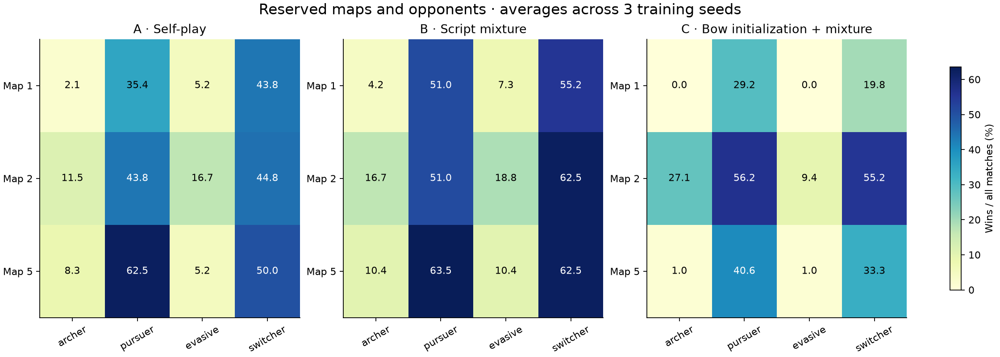

# Scripted opponents and Bow initialization

Completed 2026-09-06 (America/New_York). Steps 1–4 of the opponent-league plan:
interchangeable opponents, three qualified scripts, a frozen benchmark, and a
nine-run controlled comparison. The long-term goal remains superhuman play
across Bopl, including discovering and countering new combinations.

**Scripted opponents improved this bounded test; Bow initialization did not.**

B beat A on the final benchmark in every training seed: +9.1, +3.9 and +8.1
percentage points. C fell below B in every seed and lost the original Bow shot.
This supports the usefulness of these scripts at the tested budget, while
leaving substantial weaknesses against ranged and evasive opposition.

| Condition | Development wins | Final wins | Final W / L / draw | Final timeouts |
|---|---:|---:|---:|---:|
| A | 68/432 (15.7%) | 316/1152 (27.4%) | 316 / 726 / 110 | 109 |
| B | 101/432 (23.4%) | 397/1152 (34.5%) | 397 / 558 / 197 | 196 |
| C | 58/432 (13.4%) | 262/1152 (22.7%) | 262 / 187 / 703 | 703 |

| Comparison | Development difference, pp | Final difference, pp |
|---|---:|---:|
| B-A | +7.6 [+0.5, +14.1] | +7.0 [+3.0, +11.1] |
| C-B | -10.0 [-15.3, -4.9] | -11.7 [-15.1, -8.3] |

Brackets are descriptive 95% paired bootstrap intervals. See the limitations
below; three training seeds do not establish broad robustness.



## All nine runs

| Run | Dev wins / 144 | Final wins / 384 | Final W / L / draw | Training wall, min |
|---|---:|---:|---:|---:|
| A-s73 | 21 (14.6%) | 108 (28.1%) | 108 / 242 / 34 | 6.68 |
| A-s173 | 20 (13.9%) | 108 (28.1%) | 108 / 235 / 41 | 6.59 |
| A-s273 | 27 (18.8%) | 100 (26.0%) | 100 / 249 / 35 | 6.58 |
| B-s73 | 38 (26.4%) | 143 (37.2%) | 143 / 165 / 76 | 6.02 |
| B-s173 | 35 (24.3%) | 123 (32.0%) | 123 / 206 / 55 | 5.96 |
| B-s273 | 28 (19.4%) | 131 (34.1%) | 131 / 187 / 66 | 6.06 |
| C-s73 | 28 (19.4%) | 95 (24.7%) | 95 / 74 / 215 | 4.78 |
| C-s173 | 15 (10.4%) | 85 (22.1%) | 85 / 55 / 244 | 4.87 |
| C-s273 | 15 (10.4%) | 82 (21.4%) | 82 / 58 / 244 | 4.72 |

Total training wall time was 52.24 minutes, including
per-run startup and shutdown; recorded training loops total 48.88 minutes.
A, B and C used 19.84, 18.04 and 14.36 wall minutes respectively. Lower wall
cost in C does not indicate better learning. Evaluation, qualification and
video rendering are additional costs, recorded separately in their artifacts.

Actual training game-decision exposure was 50% current/current in all arms.
A used 50% historical; B used 14.27% historical and 35.73% scripts; C used
16.51% historical and 33.49% scripts. Assignments share the same sampling
scheme in B/C; match duration changes realized exposure.

## Where the improvement occurs

| Final opponent | A wins | B wins | C wins |
|---|---:|---:|---:|
| archer-test | 7.3% | 10.4% | 9.4% |
| pursuer-test | 47.2% | 55.2% | 42.0% |
| evasive-test | 9.0% | 12.2% | 3.5% |
| switcher-test | 46.2% | 60.1% | 36.1% |

There are 288 matches per condition/opponent. B improves the mean in all 12
final map/opponent cells, but its worst opponent remains archer at 10.4%.
C reaches only 3.5% against evasive. Scores on the final set should not be
compared directly with development as a difficulty trend: the maps and
opponent settings differ.



| Final behavior, 1,152 games each | A | B | C |
|---|---:|---:|---:|
| Arrow hits | 724 | 873 | 228 |
| Arrows fired | 9669 | 10817 | 5075 |
| Kills | 1232 | 1544 | 463 |
| Deaths | 2769 | 2425 | 1344 |
| Learner environment deaths | 1763 | 1224 | 450 |
| Opponent environment deaths | 870 | 939 | 1225 |

B lands more hits and dies less often than A. C has fewer deaths, but this
accompanies many timeouts and little effective offense. In particular C-s173
gets 85 final wins despite zero arrow hits and only three kills across 384
matches; opponents record 494 environment deaths. Its win rate cannot be read
as evidence of competent attacks. These counts identify a serious limitation
of weak scripted benchmarks without assigning a cause to every win.

Starting-policy development references: untrained seed 73 wins 14/144 (9.7%);
Bow initialization wins 19/144 (13.2%). The trained means are A 15.7%, B 23.4%
and C 13.4%. The references are descriptive single-policy checks; C shows no
clear development gain over its starting reference.

### Simultaneous-death accounting

Two raw records have both winner flags set: A-s273 final
`switcher-test-m1-p8-s0` and B-s73 final `pursuer-test-m5-p10-s0`.
Both players have zero stocks. The game’s `DeclareGameUndecided` awards
`WonThisRound` to tied last deaths. The report classifies these as draws,
following the frozen “draws not wins” metric. Raw JSON, replays and frozen
evaluator source remain unchanged; `shared_award_draws` records the conversion.
The existing training reward also uses the raw winner flag; that rare shared
award behavior was identical across conditions and was not changed during
this experiment. Plotting uncovered and reconciled it before any aggregate
comparison was reported.


## What was run

| Condition | Starting weights | Training opponents |
|---|---|---|
| A | Random, paired by seed with B | Existing current/current and current/historical |
| B | Same random weights as A | Current/current, current/script and current/historical |
| C | Bow teacher, expanded to full controls | Same assignment scheme as B |

Seeds: 73, 173, 273. Each run completed 1,001,472 learner decisions, 1,335,296
all-player decisions, and 652 PPO updates. Total: **9,013,248 learner decisions**.
Every run used the same reward, learning rate (0.0003), model and rollout sizes.
No final-set scores influenced training or checkpoint selection.

The [protocol](protocol.json) was frozen before the nine runs. Training and
development maps are 0, 3, 6; final maps are 1, 2, 5. Every evaluation swaps
player sides. Final opponents have different parameters from training and
include a reserved switcher that chooses pursuit or evasion from projectile
threats. Reset-seed repetitions on one map do not create new layouts.

Each final checkpoint has 144 development and 384 final matches: **4,752 total**.
Draws remain in the denominator of win rate; the time limit does not award a
win to the player with more remaining stocks. All policies act stochastically
at 15 Hz from the same 3,257 features with nine-tick world delay. Dash, Bow,
platform and jump controls are available. Matches have three stocks and a
3,600-tick limit. [Implementation and reproduction](../../OPPONENT_LEAGUE.md).

## Opponent qualification

Scripts consume the exact player observation vector and their own history/RNG.
They receive no current simulator state, future trajectories or privileged
opponent actions. The same evaluation interface runs scripted and neural
opponents on either side. Fixed opponent actions are excluded from PPO.

| Style | Full peer matches | W / L / timeout | Shots / hits | Observed behavior counters |
|---|---:|---:|---:|---|
| Archer | 12 | 3 / 5 / 4 | 126 / 8 | 1,381 approach and 2,087 retreat decisions |
| Pursuer | 12 | 4 / 5 / 3 | 110 / 15 | 6,434 approach decisions |
| Evasive | 12 | 2 / 3 / 7 | 143 / 5 | 4,750 retreat and 38 dodge decisions |

These 36 matches cover the three training maps, both sides and the other two
styles. Each style lands hits and sometimes wins. They are weak, configurable
training opponents; none is an expert bot. A dodge counter records a reaction
to an approaching projectile, not proof that the input prevented a hit.
Qualification against idle/random opponents is also retained in the raw data.
An early version misread a cooldown feature as an attack threat; it was fixed
and requalified before the training protocol was frozen.

[Archer clip](../../../artifacts/rl/opponent-league/videos/archer.mp4) ·
[Pursuer clip](../../../artifacts/rl/opponent-league/videos/pursuer.mp4) ·
[Evasive clip](../../../artifacts/rl/opponent-league/videos/evasive.mp4).

## Initialization and retention

C uses only the previous `teacher-fit/final.pt`, fitted to a 38-decision scripted
shot for 2,000 supervised updates. The original fitting loop took **4.76 s**;
this excludes startup, earlier research and the teacher's construction. No Bow
PPO checkpoint is used. Expansion preserves the Bow probability exactly while
giving jump, dash and platform independent initial probability 0.001. All
outputs have nonzero support and remain trainable; Adam starts fresh.

This initialization combines learned representation, aim/Bow outputs and an
initial preference against other buttons. C versus B does not isolate their
individual contributions. Equal learner decisions do not imply equal total
compute or prior effort.

The unrestricted initial network hit in 32/32 stochastic trials and the argmax
trial. After full-game training, **all nine final policies scored 0/32 and
failed argmax** on the original four-second shot. A repeat of the identical
retention evaluator on the initial weights still passed 32/32 and argmax.
Thus all three C runs lost the taught shot under this diagnostic. The result
is specific to this budget and full-game optimizer; no claim of skill retention
is justified. Lower-rate or rehearsal fixes were not included in this study.

## Replays and validation

Fixed comparison clips use seed 73, map 0, archer-dev, first seed pair, player
side 0 for all conditions; they were selected by schedule rather than outcome:
[A](../../../artifacts/rl/opponent-league/videos/A-s73.mp4) ·
[B](../../../artifacts/rl/opponent-league/videos/B-s73.mp4) ·
[C](../../../artifacts/rl/opponent-league/videos/C-s73.mp4).
The learner is the yellow character. Clips are 24-second excerpts; full native
replays are saved for the first paired sides of every map/opponent cell.

Validation includes legal script actions, reproducible private RNGs, correct
projectile threat detection, exact Bow marginal preservation, and nonzero
support for every full-game action. Changing every excluded opponent action
leaves PPO losses and updated weights bit-exact. The existing default trainer
matches the prior implementation's rollout and updated weights bit-exact.

One versus four evaluation workers produce identical match JSON and replay
hashes on the concurrency check. A complete 2,034-tick scripted match matches
ordinary replay gameplay hashes, using the existing audited presentation-field
exclusions. All six map initializations passed observation capacity checks.
Training recorded no game errors or observation overflows; evaluation checks
the same conditions on every step. The final audit checks equal budgets,
paired starting weights, binary identities, saved source hashes, final
checkpoint identities, match files, retention identities and replay hashes.
The ten frozen training/evaluation files stayed identical across all runs;
reporting and orchestration helpers were added while training ran, so the
complete source snapshot file counts differ. Every saved file matches its
recorded hash.

Raw weights, all run sources, logs, individual games, replays and qualification
attempts are preserved under `native/artifacts/rl/opponent-league/` (gitignored).
[Summary](summary.json), [audit](audit.json), figures and frozen manifests are
tracked with the implementation. Absolute paths in original manifests identify
the original workspace; tools locate checkpoints in the current artifact tree.

## Limits and next decision

Three training seeds and a small fixed set of scripted opponents constrain
inference. Bootstrap intervals resample training seeds and paired action-seed
blocks within fixed map/opponent cells; they are descriptive and do not model
uncertainty over arbitrary maps, human opponents or ability combinations.
Training and development share maps. Starting-policy development references
were declared after training began but before evaluation; they are additional
diagnostics using one untrained seed and one shared Bow initialization, not
extra three-seed experimental arms. Their [protocol](reference-protocol.json)
does not change the primary frozen comparison.

No tactical discovery is established by a win, a movement counter or an
interesting clip alone. Demonstrating useful emergent strategy would require
repeatable behavior and targeted counter-tests. This study does not implement
adaptive exploiters, new ability combinations, more players or a large league.
Those are steps 5–6 and remain outside the completed scope. The evidence
favors retaining the scripted-opponent option for further work; it does not
support promoting this Bow initialization. Stronger ranged combat and skill
retention remain unresolved before scaling the approach.

## Regenerate this report’s figures and audit

```bash
native/artifacts/rl/venv/bin/python native/rl/research/audit_league.py \
  --output native/artifacts/rl/opponent-league
python3 native/rl/research/plot_league.py \
  --artifacts native/artifacts/rl/opponent-league \
  --output native/rl/evidence/opponent-league-001
```

Plotting uses the system Python with NumPy and Matplotlib; the audit uses the
RL environment with PyTorch. Starting-policy references are optional when
plotting a fresh primary comparison.
